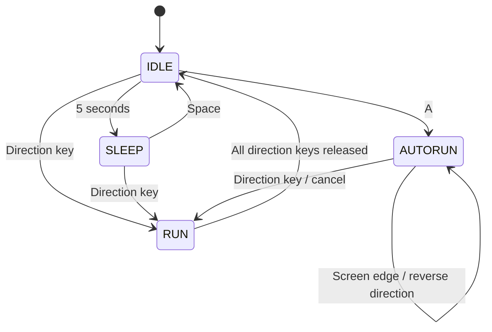

# LEC12 Character Controller

A Pico2D character-controller exercise with IDLE, SLEEP, RUN, and AUTORUN
states.

## Controls

- Left/Right: run in the selected direction; release both keys to stop.
- Space: wake up from SLEEP.
- A: start AUTORUN while IDLE. AUTORUN moves faster, appears larger, and
  reverses direction at either screen edge. Pressing a direction key cancels
  AUTORUN and continues in that direction with RUN.
- Escape: quit.

## State diagram



## Tests

Run the controller tests with:

```powershell
python -m unittest discover -s tests
```
